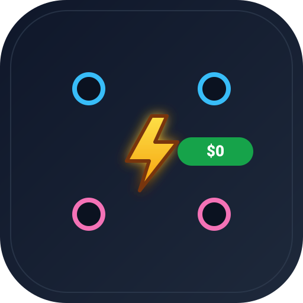

<div align="center">



# opencode-free-9router

**Paparkan model gratis OpenCode Zen sebagai satu provider yang kompatibel dengan OpenAI untuk 9Router.**
Tanpa akun OpenCode, tanpa API key, tanpa langganan — cukup adapter lokal.

Model gratis · klien free-tier teratestasi · kompatibel OpenAI · tanpa dependensi

[](https://nodejs.org)
[](../LICENSE)
[](../package.json)
[](https://platform.openai.com/docs/api-reference/chat)
[](https://9router.com)
[](https://opencode.ai)
[](https://github.com/0xgetz/opencode-free-9router/pulls)

[English](../README.md) · [Indonesia](README.id.md) · [Español](README.es.md) · [日本語](README.ja.md) · [中文](README.zh.md)

</div>

---

## Apa itu

OpenCode menyediakan **free tier** — sebelas model yang bisa kamu pakai gratis. Tapi aksesnya
dikunci: gateway menjawab `403 FreeTierError: "OpenCode's free tier can only be used from within
OpenCode"` kecuali permintaan membawa fingerprint klien resmi.

`opencode-free-9router` meniru fingerprint itu di satu adapter lokal kecil, sehingga **9Router —
dan apa pun yang mengarah ke 9Router — dapat memanggil model ini secara gratis.**

```
Klien OpenAI ──▶ 9Router :20128/v1 ──▶ provider-node "OpenCode Free"
             ──▶ adapter :8790/v1 ──▶ opencode.ai/zen/v1  (Bearer public + attestasi)
```

> Lihat **[STRUCTURE.md](../STRUCTURE.md)** untuk topologi lengkap, peta berkas dan diagram alur data.

---

## Model gratisnya

Sebelas model terverifikasi dapat diakses *end-to-end*. Set gratis berputar: model lama di-deprecate dan yang baru muncul, jadi jalankan `node src/cli.js check` kapan saja.

| Model | Konteks | Output | Input | Catatan |
|-------|---------|--------|-------|---------|
| `beam-free` | 1M | 128K | text | MoE reasoning, 23B aktif |
| `big-pickle` | 200K | 32K | text | penalaran umum |
| `cat-jam-free` | 1M | 128K | text | coding + JSON terstruktur |
| `deepseek-v4.1-flash-free` | 200K | 32K | text, image | DeepSeek V4.1 Flash |
| `glm-5.3-flash-free` | 200K | 32K | text, image, video, pdf | GLM multimodal |
| `longcat-2.5-preview-free` | 1M | 128K | text | konteks panjang |
| `mimo-v2.6-flash-free` | 200K | 32K | text | flash ringkas |
| `nemotron-3-ultra-free` | 1M | 128K | text | model besar |
| `nemotron-3.5-lightning-free` | 262K | 262K | text | latensi rendah |
| `nemotron-3.5-super-vl-free` | 1M | 128K | text, image | NVIDIA vision-language |
| `space-bunny-free` | 1M | 512K | text | output besar |

Semua memakai `POST /chat/completions`.

**Tidak melayani saat ini** (terdaftar di katalog gateway, tapi deprecated, tidak tersedia, atau protokolnya beda): `exo-free`, `fledge-alpha-free`, `ling-3.0-flash-fin-free`, `ling-3.1-flash-free`, `muse-spark-1.2-contributor-free`, `muse-spark-1.3-contributor-free`, `step-5-preview-free`. Juga tidak diproksi: `jev-1.13-free` (protokol SystemOne, ditangani native oleh 9Router).

---

## Mulai cepat

Butuh **Node.js >= 18**. Tidak ada yang perlu diinstal — nol dependensi.

```bash
git clone https://github.com/0xgetz/opencode-free-9router.git
cd opencode-free-9router

# 1. jalankan adapter (http://127.0.0.1:8790/v1)
node src/adapter.js

# 2. di shell lain, daftarkan ke 9Router (9Router harus jalan)
node src/connect-9router.js
```

Selesai. Di 9Router provider **OpenCode Free** kini menampilkan sebelas model.

### Coba model langsung

```bash
node src/cli.js ask big-pickle "Jelaskan closure dalam satu baris"
node src/cli.js check          # uji langsung setiap model
```

### Panggil adapter seperti API OpenAI biasa

```bash
curl http://127.0.0.1:8790/v1/chat/completions \
  -H 'Content-Type: application/json' \
  -d '{"model":"space-bunny-free","messages":[{"role":"user","content":"hai"}]}'
```

---

## Cara kerja gate free-tier

Gateway hanya melayani model gratis kepada yang dianggap klien OpenCode. Adapter mengirim
fingerprint teratestasi yang persis:

| Sinyal | Nilai |
|--------|-------|
| `User-Agent` | `opencode/<versi>` (versi >= 1.17) |
| `x-opencode-client` | `desktop` |
| `x-opencode-session` | `ses_<12 hex><14 base62>` — satu id stabil per identitas |
| `x-opencode-request` | `msg_<12 hex><14 base62>` — satu id stabil per turn |
| `Authorization` | `Bearer public` |
| `stream` (body) | `true` — permintaan non-stream ditolak |
| `tools` (body) | `bash`, `glob`, `grep`, `read` — kuartet fingerprint |

Semua ada di [`src/opencode_free.js`](../src/opencode_free.js) dan diuji oleh `node src/selftest.js`.

---

## Tata letak proyek

```
opencode-free-9router/
├── src/
│   ├── opencode_free.js     # attestasi, id, shaping, complete()
│   ├── adapter.js           # server HTTP kompatibel OpenAI (:8790/v1)
│   ├── connect-9router.js   # daftarkan provider ke 9Router
│   ├── cli.js               # list / ask / check
│   └── selftest.js          # uji offline + --live
├── docs/                    # README terjemahan
├── assets/                  # logo + social preview
└── STRUCTURE.md             # topologi, peta berkas, diagram
```

---

## Pengujian

```bash
npm test              # offline: 11 pemeriksaan, tanpa jaringan
npm run test:live     # sekaligus panggil setiap model gratis (lambat)
```

---

## Catatan 9Router

`connect-9router.js` terhubung ke 9Router lokal di `http://127.0.0.1:20128`. Ubah dengan:

| Variabel | Default | Arti |
|----------|---------|------|
| `ROUTER_URL` | `http://127.0.0.1:20128` | URL dasar 9Router |
| `ADAPTER_URL` | `http://127.0.0.1:8790/v1` | URL dasar adapter ini |
| `ADAPTER_API_KEY` | `sk-opencode-free` | key yang diharapkan adapter |
| `PROVIDER_NAME` | `OpenCode Free` | nama di dashboard 9Router |
| `INITIAL_PASSWORD` | `123456` | password login 9Router jika diatur |

---

## Legal dan penggunaan wajar

Proyek ini **tidak resmi** dan tidak berafiliasi dengan OpenCode maupun 9Router. Ini memakai free
tier sebagaimana klien OpenCode. Free tier punya batas dan berubah sewaktu-waktu — hormati
ketentuan layanan upstream, jaga volume permintaan tetap wajar, dan jangan menjual ulang aksesnya.
Gunakan dengan risiko sendiri.

---

## Lisensi

[MIT](../LICENSE) © 2026 0xgetz
